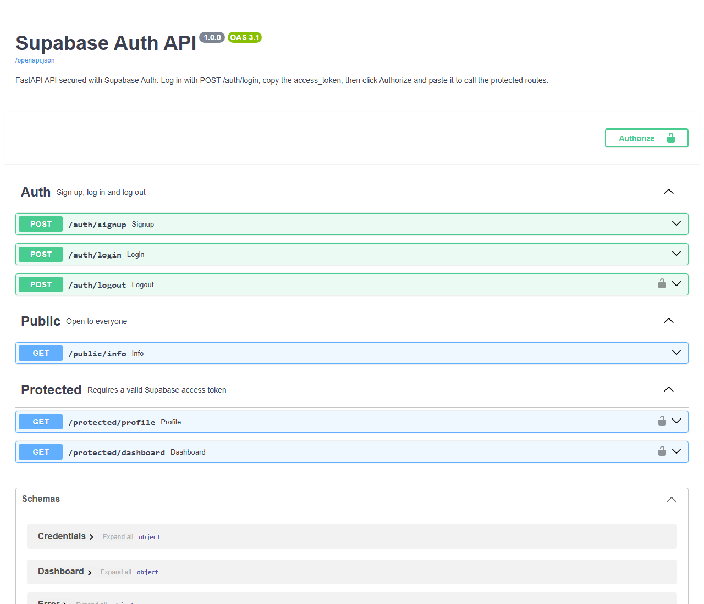

# Supabase Auth API

A small REST API that shows how to secure endpoints with **Supabase Auth**. Users sign up and log in to get a JWT access token. A reusable FastAPI dependency checks that token with Supabase before any protected route runs.

Built with **Python, FastAPI and Uvicorn**, the **Supabase Python SDK** (`supabase-py`), and **Swagger UI** (built into FastAPI) for interactive docs.



## Features

- `POST /auth/signup` and `POST /auth/login` backed by `supabase.auth.sign_up()` and `supabase.auth.sign_in_with_password()`
- A public route anyone can call, and protected routes that need `Authorization: Bearer <token>`
- `require_auth` dependency that verifies the token with `supabase.auth.get_user(token)`
- `POST /auth/logout`, which ends the session behind the token
- Swagger UI at `/docs` with an **Authorize** button for bearer tokens

## Prerequisites

- Python **3.10 or newer**
- A free [Supabase](https://supabase.com/) project

## Setup

### 1. Clone and install

```bash
git clone https://github.com/kwibuloy/Flyrank_Week4.git
cd Flyrank_Week4
python -m venv .venv
```

Activate the virtual environment (`.venv\Scripts\activate` on Windows, `source .venv/bin/activate` on macOS/Linux), then install:

```bash
pip install -r requirements.txt
```

### 2. Configure environment variables

Copy the example file and fill in your own Supabase values:

```bash
cp .env.example .env
```

```env
SUPABASE_URL=your_project_url
SUPABASE_KEY=your_anon_key
PORT=3000
```

| Variable | Where to find it |
|---|---|
| `SUPABASE_URL` | Supabase Dashboard → Project Settings → API → **Project URL** |
| `SUPABASE_KEY` | Supabase Dashboard → Project Settings → API Keys → **anon / public** key |
| `PORT` | Port the server listens on (default `3000`) |

`.env` is listed in `.gitignore`. Never commit it.

### 3. Turn off email confirmation (for local testing)

Supabase requires users to confirm their email by default, so logins fail until they do. For local testing, go to **Authentication → Sign In / Providers → Email** and switch off **Confirm email**.

### 4. Run it

```bash
python -m app.main
```

You should see:

```
Server running and connected to Supabase on http://localhost:3000
```

The server checks Supabase's Auth health endpoint before it starts, so a wrong URL or key fails right away with a clear error.

During development you can use auto-reload instead: `uvicorn app.main:app --reload --port 3000`.

## API reference

| Method | Endpoint | Auth required | Description | Success | Errors |
|---|---|---|---|---|---|
| `POST` | `/auth/signup` | No | Register with `{ email, password }` | `201` user object | `400` missing fields / invalid JSON / Supabase rejection |
| `POST` | `/auth/login` | No | Log in with `{ email, password }` | `200` `access_token`, `refresh_token` | `400` missing fields, `401` invalid credentials |
| `POST` | `/auth/logout` | **Yes** (Bearer) | End the session behind this token | `204` no content | `401` |
| `GET` | `/public/info` | No | Public welcome message | `200` | — |
| `GET` | `/protected/profile` | **Yes** (Bearer) | Verified user's id, email, created/last sign-in dates | `200` | `401` |
| `GET` | `/protected/dashboard` | **Yes** (Bearer) | Dashboard greeting for the verified user | `200` | `401` |
| `GET` | `/docs` | No | Swagger UI | `200` | — |

### Errors returned by protected routes

| Situation | Status | Body |
|---|---|---|
| No `Authorization` header, not `Bearer`, or no token | `401` | `{ "error": "Access token required" }` |
| Token expired, tampered with, or signed out | `401` | `{ "error": "Invalid or expired token" }` |

## Try it with curl

```bash
# Sign up
curl -i -X POST http://localhost:3000/auth/signup -H "Content-Type: application/json" -d '{"email":"test@example.com", "password":"password123"}'

# Log in and copy the "access_token" from the response
curl -i -X POST http://localhost:3000/auth/login -H "Content-Type: application/json" -d '{"email":"test@example.com", "password":"password123"}'

# Public route
curl -i http://localhost:3000/public/info

# Protected route
curl -i http://localhost:3000/protected/profile -H "Authorization: Bearer <PASTE_YOUR_ACCESS_TOKEN_HERE>"

# Log out
curl -i -X POST http://localhost:3000/auth/logout -H "Authorization: Bearer <PASTE_YOUR_ACCESS_TOKEN_HERE>"
```

## Try it in Swagger UI

1. Open http://localhost:3000/docs
2. Run **POST /auth/login** with **Try it out** and copy the `access_token`
3. Click **Authorize**, paste the token, then click **Authorize** and **Close**
4. Run **GET /protected/profile** with **Try it out**. It returns `200` with your user details.

## Project structure

```
├── app/
│   ├── main.py                # FastAPI app: routers, error handlers, /docs, landing page
│   ├── supabase_client.py     # Supabase client + connection check
│   ├── token.py               # Reads the Bearer token from the Authorization header
│   ├── dependencies.py        # require_auth: verifies the token with Supabase
│   ├── schemas.py             # Response models and error examples for the docs
│   └── routers/
│       ├── auth.py            # /auth/signup, /auth/login, /auth/logout
│       ├── public.py          # /public/info
│       └── protected.py       # /protected/profile, /protected/dashboard
├── docs/swagger-ui.png        # Screenshot used in this README
├── requirements.txt           # Pinned dependencies
└── .env.example               # Template for your own .env
```

## Notes

- **Logout:** `supabase.auth.sign_out()` only signs out the session held by the client itself, and this server doesn't hold one. To end a session from a raw access token, the server calls `supabase.auth.admin.sign_out(token)`. Despite the `admin` namespace, this only needs the user's own JWT and the anon key, not the service role key. After logout, that token is rejected.
- **Stateless server:** the Supabase client runs with `persist_session=False`. Each login uses a fresh client, so one user's session is never kept in shared state.
- **Clear errors:** every error is JSON shaped as `{ "error": "..." }`. Missing fields and malformed JSON return `400` (FastAPI's default would be `422`), and the OpenAPI docs list only the status codes the API actually returns.
- **OpenAPI spec:** FastAPI generates it from the code, so it can't drift from the routes. It is served at `/openapi.json`.
